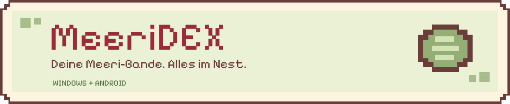
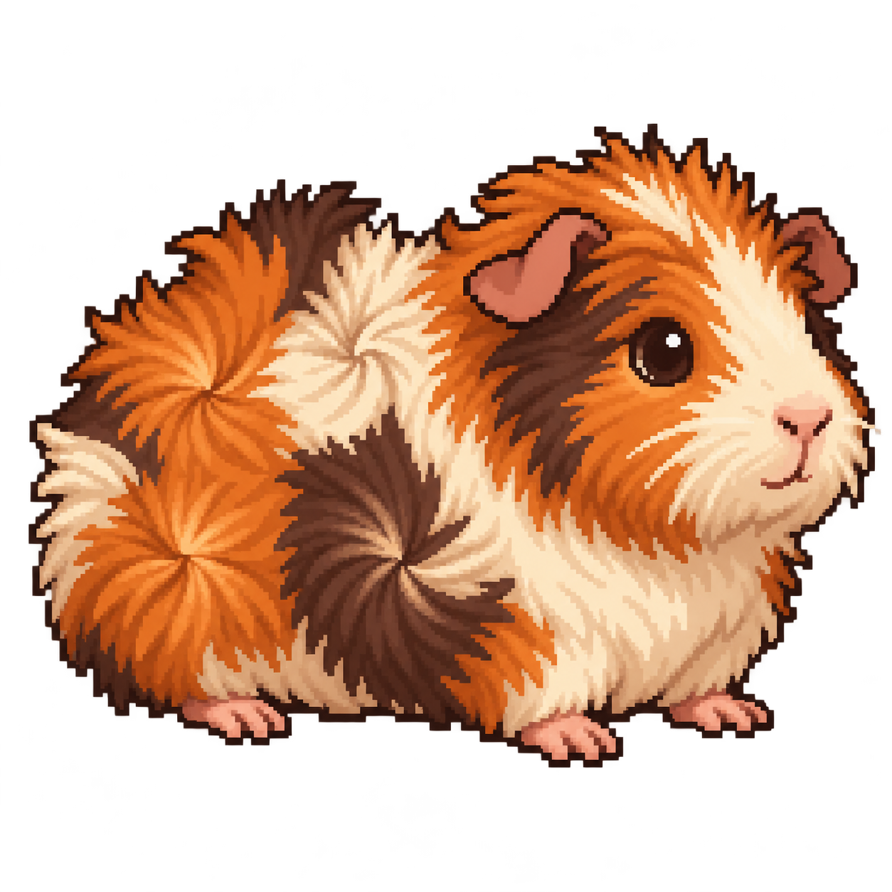
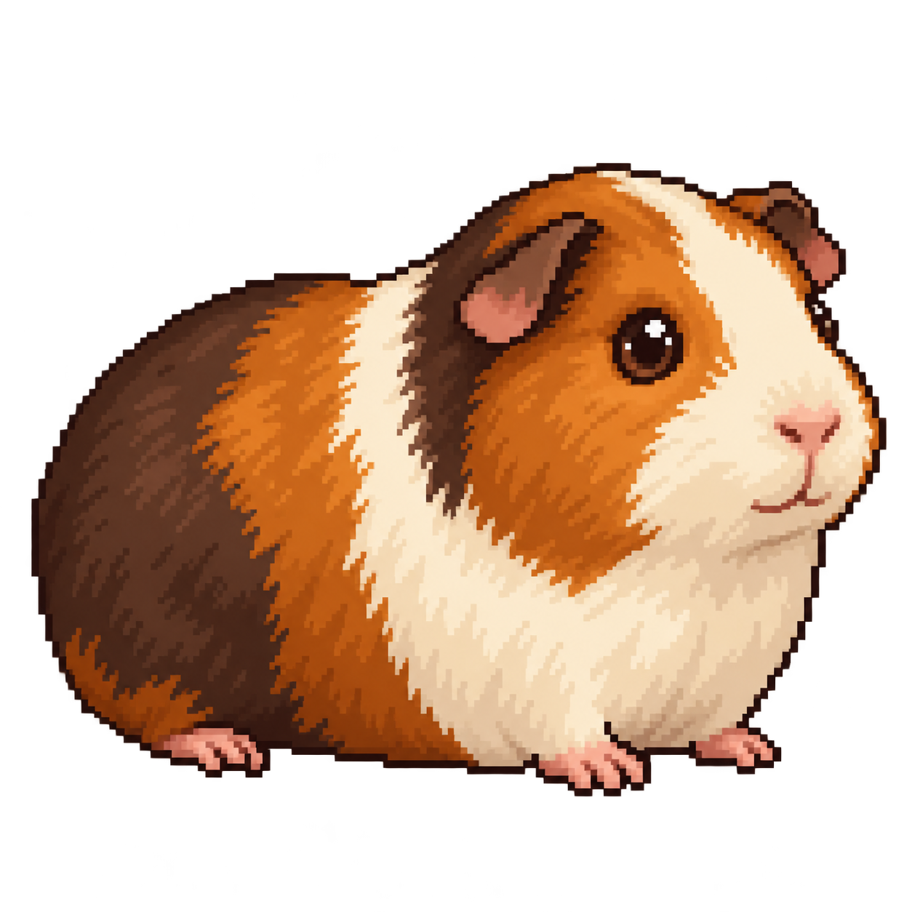



  

# MeeriDEX & MeeriDex Companion

Ein gemütliches Zuhause für deine Meerschweinchenkartei: **Tiere und Fotos verwalten, Stammbäume entdecken, Gewichte verfolgen und deine Zucht im Blick behalten** – im verspielten Pixellook. Am Windows-PC planst und verwaltest du deine Bande; mit der Android-App fotografierst und erfasst du direkt bei deinen Meeris. Beide gleichen ihre Daten im privaten WLAN ab.

## Schnellstart & Downloads

  
  

| Am Windows-PC einziehen | Auf Android loslegen |
| --- | --- |
| **1.** Programm-ZIP laden und vollständig in einen eigenen, beschreibbaren Ordner entpacken. | **1.** Die APK direkt auf dem Handy herunterladen und öffnen. |
| **2.** `MeeriDEX.exe` starten, Lizenz aktivieren und Züchterprofil ausfüllen. | **2.** Falls angefordert, die Installation für die verwendete Downloadquelle erlauben und **Installieren** wählen. |
| **3.** Unter **Meine Meeris → + Tier hinzufügen** die erste Fellnase anlegen. | **3.** Ein Tier anlegen oder die App über **Sync** mit dem PC verbinden. |

**Voraussetzungen:** Windows 10/11 mit .NET Framework 4.8 oder passender neuerer 4.x-Laufzeit · Android ab 8.0. **Windows braucht eine Lizenz; Android bleibt kostenlos.** Companion ist eine Testversion außerhalb des Play Stores.

[Windows-EXE einzeln / Releasehinweise](https://github.com/Coupe5E/MerriDex/releases/latest) · [Android-Release](https://github.com/Coupe5E/MerriDex/releases/tag/companion-v0.8.6) · [.NET von Microsoft](https://dotnet.microsoft.com/en-us/download/dotnet-framework/thank-you/net48-offline-installer)

**Hilfe beim ersten Start:** [Windows installieren & SmartScreen](docs/Handbuch.md#windows-smartscreen-beim-download-oder-start) · [Android Schritt für Schritt & Warnmeldungen](docs/Handbuch.md#android-installieren--schritt-für-schritt) · [Windows 7](docs/Handbuch.md#hinweis-zu-windows-7)

> **Schon eine Bande angelegt?** Am PC **Updates prüfen** verwenden. Manuell die EXE im bisherigen Datenordner ersetzen, nachdem MeeriDEX geschlossen und gesichert wurde. Die Android-App beim Aktualisieren **nicht deinstallieren**, damit lokale Tiere und Fotos erhalten bleiben. `.sha256` und GitHubs „Source code“-Archive sind keine Installationspakete.

---

## Ein Blick in dein Meeri-Nest

  
  

### MeeriDEX · Die ganze Bande am Windows-PC

| Bereich | Das steckt drin |
| --- | --- |
| **Meine Meeris & Profile** | Tiere anlegen, suchen und bearbeiten: Name, Geschlecht, Geburtstag, Rasse, Farbe, Herkunft, Eltern, Notizen und Kastrationsangaben. Mehrere Fotos pro Tier und optionale RFID-Chipnummern gehören dazu. |
| **Familie & Stammbäume** | Mutter, Vater und Geschwister verknüpfen, Familienbäume über drei bis sechs Generationen erkunden und Profile direkt öffnen. |
| **A4-Stammbaum & PDF** | Einen Stammbaum mit Tierfoto, größeren Pixelbildern der Vorfahren und deinem Zuchtlogo als A4-PDF speichern oder drucken. Mit Vorschau, Zoom und Ryos Leselupe. |
| **Gewicht & Erinnerungen** | Messungen mit Datum erfassen und als Verlauf ansehen. Eigene Aufgaben mit Termin, Wiederholung und Notizen anlegen, abhaken oder verschieben. |
| **Verpaarungen & Würfe** | Käfige und Tiergruppen planen, Start- und Enddaten festhalten und Würfe mit Eltern, Jungtieren und M/W/T-Quote verwalten. |
| **Farben & WurfOrakel** | Rassen, Farbvorlagen, Codes und bekannte Trägergene erfassen; mögliche Genpaare des Nachwuchses ansehen. Unvollständige Angaben bleiben als solche erkennbar. |
| **Krankenstation** | Befunde, Verdachtsfälle, Behandlungen und Krankheitsverläufe dokumentieren sowie Familienbeziehungen nachsehen. |
| **Abgabe & MeeriHimmel** | Ausgezogene Tiere mit Datum, Kontaktangaben und optionalem Verkaufspreis verwalten. Verstorbene Meeris behalten ihr Profil, ihre Fotos und ihren Platz im Stammbaum. |
| **Züchterprofil** | Zuchtname, Ort, Kontakte und ein eigenes Logo hinterlegen; Vorgaben für neue Tiere übernehmen. |
| **Sicherungen & Import** | ZIP-Sicherungen, Excel-Import/-Export und MeeriPro3-ZIP-Übernahme. Vor Programmupdates erstellt MeeriDEX automatisch eine ZIP- und eine Excel-Sicherung. |
| **Pixel-Meeris & kleine Extras** | Passende Rassen- und Farbbilder, bis zu vier eigene Meeris mit Namen im Kopfbereich, pixelige „So geht’s“-Sprechblasen und eine abschaltbare Kötelparty. |

**Eigene Tiere gehören unter „Meine Meeris“.** „Tiere für den Stammbaum“ ist für Vorfahren und andere Tiere außerhalb deines aktuellen Bestands gedacht. [Mehr zur Familie und zum Stammbaum](docs/Handbuch.md#eigene-tiere-und-stammbaum-richtig-anlegen)

<strong>Farben, Gene und das WurfOrakel – was die Angaben bedeuten</strong>

Rassen- und Farbvorlagen sind Hilfen zur Eingabe, kein Nachweis der individuellen Gene eines Tiers. Eigene Angaben und bekannte Trägergene sind möglich. Das WurfOrakel berechnet mögliche Genpaare aus den gespeicherten Angaben; Unbekanntes führt zu Spannen. Nicht alle genetischen Faktoren werden berechnet. Das Ergebnis bestätigt weder eine vollständige Gesamtfarbe noch die gesundheitliche Eignung einer Verpaarung. Die Krankenstation dokumentiert Angaben und stellt keine Diagnose.

Pixelbilder sind passende Illustrationen und keine exakt rekonstruierten Tierfotos. Je nach Zuordnung können ähnliche Farben ein Gruppenbild derselben Rasse verwenden.

<strong>Eine kleine Gurkenpause: die Kötelparty</strong>

Jedes angezeigte Pixel-Meeri hat seinen eigenen Zufallstimer von 12 bis höchstens 90 Sekunden. Kleine Kötel hüpfen über die Oberfläche, rollen und bleiben unten liegen. Greif sie mit der linken Maustaste und zieh sie in den Pixel-Mülleimer unten rechts – flupp!

Unter **Optionen → Kötelparty** ein-/ausschalten und Platz für **1–200 Kötel** einstellen (Standard: 50). Beim Ansichtswechsel wird aufgeräumt; ist die Grenze voll, räumt der nächste neue Kötel ebenfalls auf. Die Spielerei verändert keine Tierdaten.

[Ausführliches Handbuch: A4/PDF, Würfe, Abgabe, Zuchtlogo, RFID/TASSO und Import](docs/Handbuch.md)

### MeeriDex Companion · Bei deinen Meeris auf Android

| Unterwegs | Das kannst du machen |
| --- | --- |
| **Tierliste & Profile** | Meeris mit Pixelbild, Name und Geschlecht finden; suchen, filtern und Favoriten markieren. Neue Tiere mit Stammdaten, RFID, Eltern, Rasse, Farbe und Codes anlegen. |
| **Kamera & Fotos** | Mit der Handykamera direkt zum Profil fotografieren oder bestehende Bilder auswählen. Mehrere Fotos pro Tier verwalten. |
| **Schnell wiegen** | Direkt aus der Liste oder im Profil eine Messung eintragen und den kleinen Gewichtsverlauf ansehen. |
| **Familie, Würfe & Erinnerungen** | Eltern und Großeltern im mobilen Stammbaum öffnen, Familienprofile ansehen, Würfe erfassen und Merkzettel pflegen. |
| **Züchterprofil & Vorgaben** | Das übertragene PC-Züchterprofil ansehen und Zuchtname sowie Geburtsort für neue Tiere vorbelegen. |
| **WLAN & Updates** | Lokal arbeiten, später mit dem PC abgleichen und neue APK-Versionen über die App laden. |

**Die beiden ergänzen sich:** Größere grafische Stammbäume, PDF-Ausgabe, Verpaarungsverwaltung und WurfOrakel gehören zum Desktop. Krankenverläufe und bestehende Abgabedaten lassen sich unterwegs nachlesen; Kontakte der übernehmenden Person können in Companion bearbeitet werden. Das vollständige Züchterprofil wird am PC gepflegt. Companion ist derzeit für Android erhältlich; eine iPhone-Version gibt es nicht.

<strong>Android installieren oder aktualisieren?</strong>

Die APK wird direkt von GitHub installiert. Je nach Android-Gerät muss die verwendete Downloadquelle dafür freigegeben werden. Warte eine angebotene Sicherheitsprüfung ab. Eine Quellenfreigabe und eine konkrete Schadsoftware-Erkennung sind unterschiedliche Meldungen; bei einer konkreten Erkennung Installation abbrechen und den genauen Text melden.

[Alle Installationsschritte und Warnmeldungen erklärt](docs/Handbuch.md#android-installieren--schritt-für-schritt)

Für Updates die neue APK über die vorhandene App installieren. **Nicht vorher deinstallieren oder App-Daten löschen.** Sehr alte Companion-Versionen können große APKs nicht über den Updater laden; dann die aktuelle APK einmalig direkt von GitHub installieren.

## PC & Handy zusammenbringen

**Im selben privaten WLAN, ohne Cloud-Konto für deine Tierkartei.** Ein PC am LAN-Kabel im selben Heimnetz funktioniert ebenfalls.

1. Am PC **Sync** öffnen und das Fenster offen lassen.
2. In Companion **PC verbinden / QR-Code scannen** wählen und den PC-Code scannen.
3. Die Handy-Anfrage und gegebenenfalls die angebotene lokale Netzwerkfreigabe am PC bestätigen.
4. Rückfragen zu Konflikten prüfen und beide Abschlussmeldungen abwarten.

Tierprofile und Fotos werden in beide Richtungen übertragen. Das Züchterprofil kommt vom PC zur App. Vor dem Speichern eines Abgleichs legt der PC ZIP- und Excel-Sicherungen an. Eine zusätzliche Kopie auf einem anderen Datenträger bleibt sinnvoll.

[Ausführliche Sync-Anleitung & Verbindungsprobleme](docs/Handbuch.md#pc-und-app-synchronisieren)

## Wenn mal ein Meeri quer sitzt

| Du brauchst Hilfe bei … | Hier geht’s weiter |
| --- | --- |
| Windows-Start, .NET oder SmartScreen | [Windows installieren](docs/Handbuch.md#desktop-installieren-und-aktualisieren) · [.NET-Hilfe](docs/Handbuch.md#net-framework-kostenlos-nachinstallieren) · [PC-Probleme](docs/Handbuch.md#probleme-am-pc) |
| APK-Installation oder Android-Warnung | [Schritt für Schritt](docs/Handbuch.md#android-installieren--schritt-für-schritt) · [App-Probleme](docs/Handbuch.md#probleme-in-der-app) |
| Fehlenden Tieren/Bildern nach einem Umzug | Den bisherigen Programmordner mit `meeridex.sqlite` und `Profil` verwenden. [Daten aufbewahren](docs/Handbuch.md#desktop-installieren-und-aktualisieren) |
| Verbindung zwischen PC und Handy | [WLAN-Sync prüfen](docs/Handbuch.md#pc-und-app-synchronisieren) |
| Einem anderen Fehler | [Problem melden](https://github.com/Coupe5E/MerriDex/issues) – Version, System, Schritte und genauen Fehlertext angeben. |

Bitte keine Tierkarteien, Kontaktdaten, Lizenzschlüssel oder QR-/Kopplungscodes öffentlich posten. [Was bei einer Fehlermeldung hilft](docs/Handbuch.md#problem-melden)

## Lizenz & ein Gürkchen für die Entwicklung

**MeeriDEX für Windows** benötigt eine personalisierte Lizenz mit Vorname, Nachname und Zuchtname. Eine Lizenz kann auf zwei PCs gleichzeitig genutzt werden. Es gibt manuell vergebene Dauerlizenzen und 15-Tage-Testlizenzen. Die erste Aktivierung erfolgt online; spätestens alle 30 Tage ist eine erneute Prüfung nötig, bei Tests höchstens bis zum Testende. Der Lizenzdienst erhält keine Tierprofile oder Tierfotos. **Companion bleibt kostenlos.**

Ohne gültige Bestätigung können vorhandene Daten ausdrücklich im Lesemodus geöffnet und als ZIP/Excel exportiert werden. Speichern, Import und Sync benötigen am PC eine gültige Lizenz.

Du möchtest ein Gürkchen dalassen? [Freiwillig über PayPal unterstützen](https://paypal.me/SaschaGau). Der Knopf **Gürkchen spendieren** ist auch in beiden Anwendungen zu finden.

---

MeeriDEX und Companion sind **Closed Source**. Dieses öffentliche Repository ist für Downloads, Hilfen und Updates bestimmt. Die eigenen Programmquellen bleiben privat. Copyright © 2026 Coupe5E; alle Rechte vorbehalten. Siehe `LIZENZ.txt` im jeweiligen Release. [Hinweise zur Pixelschrift](docs/assets/PixelifySans-OFL.txt)

Die ältere Schreibweise in der GitHub-Adresse bleibt wegen der Update-Kompatibilität erhalten.

*Stand: 28.10.2026 · Windows 1.9.15 · Companion 0.8.6 · [Alle Releases](https://github.com/Coupe5E/MerriDex/releases)*
